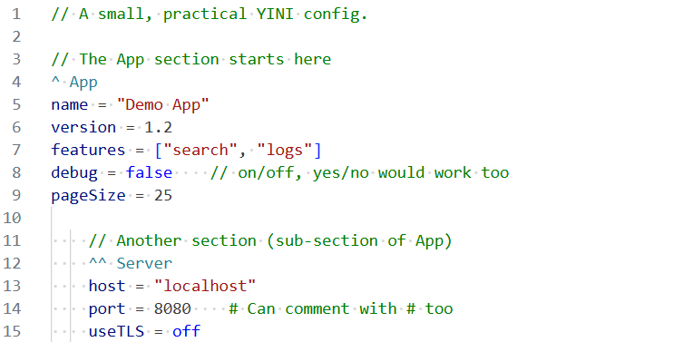
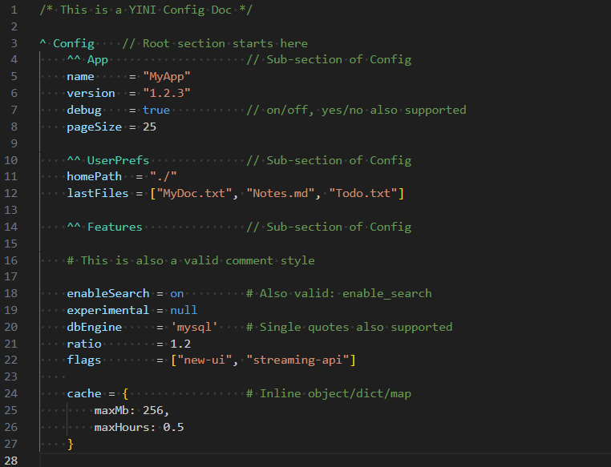

# yini-parser-typescript

The official **YINI** parser for JavaScript and TypeScript on Node.js.

YINI is a configuration format with comments, lists, and nested sections.
Section markers define the nesting, so indentation is optional.

[](https://www.npmjs.com/package/yini-parser)
[](https://github.com/YINI-lang/yini-parser-typescript/actions/workflows/yini-test-suite.yml)
[](https://github.com/YINI-lang/yini-parser-typescript/actions/workflows/run-all-tests.yml)

Useful links:
- [Try YINI in Playground](https://yini-lang.org/playground/?utm_source=github&utm_campaign=yini_parser_ts&utm_content=readme_project_links&utm_medium=referral)
- [This yini-parser on GitHub](https://github.com/YINI-lang/yini-parser-typescript)
- [Report an Issue or give Feedback](https://github.com/YINI-lang/yini-parser-typescript/issues)

## Quickstart

Requires Node.js 20 or later.

Install:

```sh
npm install yini-parser
```

Create `example.cjs`:

```js
const { parse } = require('yini-parser')

const data = parse(`
^ Application
name = "demo"

^^ Server
port = 8080
`)

console.log(data)
```

Run:

```sh
node example.cjs
```

Expected output:

```js
{
  Application: {
    name: 'demo',
    Server: {
      port: 8080,
    },
  },
}
```

---

## Parsing modes

The default mode is lenient. Strict mode adds stricter checks on the document's
structure and syntax:

| Rule | Lenient mode | Strict mode |
| --- | --- | --- |
| `/END` document terminator | Optional | Required |
| Top-level members outside sections | Allowed | Rejected |
| Top-level sections | Any number | Exactly one |
| Duplicate keys | Keep the first value and warn | Error |
| Duplicate sections under the same parent | Error | Error |
| Empty values in top-level or section members | Treat as `null` and warn | Error |

Enable strict mode when reading a file:

```ts
import YINI from 'yini-parser'

const config = YINI.parseFile('./config.yini', {
  strictMode: true,
})
```

The file must contain one top-level section and end with `/END`. Some rules can
be overridden with options such as `requireDocTerminator` and `onDuplicateKey`.

Lenient mode tries to recover from errors and may return partial data. Set
`failLevel: 'errors'` to stop and throw on an error. See
[Error handling and diagnostics](#error-handling-and-diagnostics) below.

See the [YINI specification and documentation](https://yini-lang.org/refs/specification?utm_source=github&utm_campaign=yini_parser_ts&utm_content=readme&utm_medium=referral).

## Numbers and strings

### Integers and upgrading to 2.0

Version 2.0 returns integers outside JavaScript's safe integer range as `bigint`
so their values stay exact. Smaller integers are still returned as `number`.
For example, `9007199254740993` becomes `9007199254740993n`. Integers outside the
signed 64-bit range are rejected.

This is a breaking change for code that expects every number to be a JavaScript
`number`. `JSON.stringify` cannot serialize `bigint` directly, and converting a
large `bigint` to `number` can lose precision. Choose a JSON representation that
keeps the values your application needs. See [CHANGELOG.md](./CHANGELOG.md) for
the release changes.

For binary numbers, use the `0b` prefix. The older `%` prefix is accepted with a
deprecation warning in both modes.

### Escaped strings

Backslashes are literal in ordinary quoted strings. Prefix a string with `E` or
`e` to interpret escape sequences such as `\n` and `\t`. The deprecated `C` and
`c` prefixes remain accepted aliases, including for triple-quoted strings.

```yini
^ Message
raw = "Line 1\nLine 2"       // Keeps the backslash and n.
escaped = E"Line 1\nLine 2"  // Contains a newline.
```

### Command strings

Use lowercase `command"""` followed immediately by a line break for multiline command or
script text. The first nonempty line sets the indentation to remove from each
content line. Extra indentation and literal backslashes are kept. Source line
endings become LF (`\n`). The closing `"""` must be alone on its line, apart from
leading spaces.

```yini
^ Scripts
build = command"""
    npm install
    npm run build
"""
```

Command strings produce text. The parser does not run the commands. Ordinary
triple-quoted strings also support multiple lines, but keep their indentation.
Source line endings become LF in all multiline string values; characters
produced by escapes, such as `\r\n`, stay unchanged.

---

## Usage

### Other package managers

With **yarn**:
```sh
yarn add yini-parser
```

With **pnpm**:
```sh
pnpm add yini-parser
```

### Node.js (CommonJS)
Use `.default` to access the `YINI` class with `require`. Named functions such as
`parse`, `parseFile`, and `parseForTooling` are also available, as shown in the
quickstart.

```js
const YINI = require('yini-parser').default

// Parse from string.
const config = YINI.parse(`
    ^ App
    title = 'My App Title'
    items = 25
    isDarkTheme = true
`)

// Parse from file.
const configFromFile = YINI.parseFile('./config.yini')
```

### TypeScript (with `"esModuleInterop": true`)
```ts
import YINI from 'yini-parser'

// Parse from string.
const config = YINI.parse(`
    ^ App
    title = "My App Title"
    items = 25
    isDarkTheme = OFF
`)

// Parse from file.
const configFromFile = YINI.parseFile('./config.yini')
```

`config` in the TypeScript example contains:
```js
// JS object
{
   App: {
      title: "My App Title",
      items: 25,
      isDarkTheme: false
   }
}
```

### JavaScript (ES modules)

```js
import { parse } from 'yini-parser'

const config = parse('^ App\nenabled = true\n')
console.log(config.App.enabled) // true
```

### Error handling and diagnostics

`parse` and `parseFile` print errors and warnings to standard error (stderr) by default. Set
`logDiagnostics: false` when your application handles the messages itself.

To stop on errors in either mode, set `failLevel: 'errors'`. With the default
`throwOnError: true`, an error then throws an exception:

```js
const { parseFile } = require('yini-parser')

try {
  const config = parseFile('./config.yini', {
    failLevel: 'errors',
    logDiagnostics: false,
  })
  console.log(config)
} catch (error) {
  console.error(error.message)
}
```

Use `parseForTooling` for editors, linters, and other tools. It returns
`{ ok, result, diagnostics }` without printing diagnostics or throwing for
normal parse errors. If `ok` is `false`, `result` may contain partial data.

```js
const { parseForTooling } = require('yini-parser')

const parsed = parseForTooling('^ App\nname = "demo"')
// { ok: true, result: { App: { name: 'demo' } }, diagnostics: [] }
```

For the full metadata from `parse` or `parseFile`, set `includeMetadata: true`.
Add `includeDiagnostics: true` for structured diagnostics and
`includeTiming: true` for timing information. See the
[public option types](./src/types/index.ts) for all available options.

---

## 📂 More Examples

After cloning this repository and running `npm install`, you can run the local examples from the repository root:

```sh
npm run example1
npm run example2
npm run example3
```

- `example1` parses a basic YINI file.
- `example2` parses nested YINI sections.
- `example3` demonstrates tooling-style parsing with diagnostics.
- Additional [YINI examples](https://yini-lang.org/learn-yini/examples/?utm_source=github&utm_campaign=yini_parser_ts&utm_content=readme&utm_medium=referral).
- [Demo apps](https://github.com/YINI-lang/yini-demo-apps/tree/main) with usage examples.

A YINI file with nested sections and comments:



Source: [basic.yini](./samples/basic.yini)

<details>
<summary>View a larger YINI configuration example</summary>

> A real-world YINI configuration example, showing sections, nesting, comments, and multiple data types:  

Source: [config.yini](./samples/config.yini)

</details>

---

## Why YINI?

YINI is designed for configuration files that people read and edit by hand.
It uses section markers for nesting, supports comments, and provides strings,
numbers, booleans, null, lists, and inline objects.

Compared with common configuration formats:
- **INI:** YINI defines nested sections and value types.
- **JSON:** YINI allows comments and uses section headers to group settings.
- **YAML:** YINI does not use indentation to define structure.
- **TOML:** YINI uses explicit section markers for hierarchy instead of dotted table names.

The same small configuration can be written in several formats:

### YINI
```yini
^ Application
name = 'demo'
environment = 'dev'

^^ Server
host = 'localhost'
ports = [8080, 8081]

^^^ TLS
enabled = true
mode = 'optional'
```

- `Application` contains the top-level application settings.
- `Server` is nested under `Application`.
- `TLS` is nested under `Server`.
- The section markers `^` define the nesting. Spaces and tabs inside strings still matter.
- Strings can use either `'` or `"`.

<details>
<summary>Compare this example with JSON, YAML, and TOML</summary>

### JSON
```json
{
  "Application": {
    "name": "demo",
    "environment": "dev",
    "Server": {
      "host": "localhost",
      "ports": [8080, 8081],
      "TLS": {
        "enabled": true,
        "mode": "optional"
      }
    }
  }
}
```

### YAML
```yaml
Application:
  name: demo
  environment: dev
  Server:
    host: localhost
    ports:
      - 8080
      - 8081
    TLS:
      enabled: true
      mode: optional
```

### TOML
```toml
[Application]
name = "demo"
environment = "dev"

[Application.Server]
host = "localhost"
ports = [8080, 8081]

[Application.Server.TLS]
enabled = true
mode = "optional"
```

</details>

## Parser implementation

The parser uses code generated by ANTLR together with handwritten TypeScript.
The npm package includes the generated code and uses the `antlr4` runtime.
Java and the ANTLR generator are only needed when maintainers regenerate the
parser sources.

---

## Feedback and bug reports

Use GitHub to report problems or ask questions:
- [Report a bug or issue](https://github.com/YINI-lang/yini-parser-typescript/issues)
- [Start a discussion](https://github.com/YINI-lang/yini-parser-typescript/discussions)

When reporting parser behavior, it is helpful to include:
- The YINI input that caused the issue.
- The expected result.
- The actual result or error message.
- The installed `yini-parser` and Node.js version.

---

## 🧪 Testing and Stability

The repository includes unit, integration, smoke, and regression tests for both
parsing modes and the public API. Run them from the repository root:

```sh
npm test
```

The parser also passes all **542 cases** in
[`yini-test-suite` 0.4.0rc1](https://github.com/YINI-lang/yini-test-suite), covering
the YINI Specification **1.0.0-RC.7** snapshot. This includes smoke and golden
cases in lenient and strict modes, with **0 failures**. The language
specification is still a release candidate.

---

## Links
- [YINI Cheat Sheet](https://yini-lang.org/refs/yini-cheat-sheet/?utm_source=github&utm_campaign=yini_parser_ts&utm_content=readme_links_cheat_sheet&utm_medium=referral)
- [YINI Specification](https://yini-lang.org/refs/specification/?utm_source=github&utm_campaign=yini_parser_ts&utm_content=readme_links_specification&utm_medium=referral)
- [YINI Demo Apps (source code)](https://github.com/YINI-lang/yini-demo-apps/tree/main)  

---

## 🤝 Contributing
Bug reports, feature requests, documentation fixes, and code contributions are welcome.

### Documentation
- [Project setup](./docs/Project-Setup.md) — How to run, test, and build the project.
- [Conventions](./docs/Conventions.md) — Code style and naming rules.

---

## License
This project is licensed under the Apache License 2.0 — see the [LICENSE](./LICENSE) file for details.

Third-party tools under `libs` have their own licenses.

---

**^YINI ≡**  
> YINI is a human-readable configuration format designed for clarity, readability, explicit structure, and predictable parsing.
> 
> See the specification for syntax and format details.  

[yini-lang.org](https://yini-lang.org/?utm_source=github&utm_campaign=yini_parser_ts&utm_content=readme_footer&utm_medium=referral) · [YINI-lang on GitHub](https://github.com/YINI-lang)
